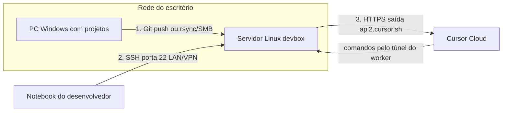

# Runbook de infra — Servidor Linux local para projetos (Windows → Linux + Cursor)

**Status:** pronto para execução pela equipe de infra  
**Data:** 12 de setembro de 2026  
**Público:** infraestrutura, redes e desenvolvimento  
**Objetivo:** provisionar um servidor Linux **dentro da rede do escritório**, migrar os projetos que hoje estão no computador Windows e permitir edição remota (SSH + Cloud Agent no próprio servidor).

Este documento é um **pedido de implantação**. A infra deve preencher os campos entre `< >`, executar os passos na ordem e devolver o relatório da seção 11.

---

## 0. Dados que a infra deve preencher

| Item | Valor |
|---|---|
| Hostname do servidor | `<HOSTNAME>` (sugestão: `devbox-escritorio`) |
| IP interno (LAN) | `<IP_LINUX>` |
| Sistema operacional | Ubuntu Server 24.04 LTS x86_64 (recomendado) |
| Disco útil para projetos | mínimo 200 GB SSD (ajustar ao tamanho real das pastas no Windows) |
| RAM / CPU | mínimo 16 GB RAM / 4 vCPU (32 GB se vários agentes simultâneos) |
| Usuário de desenvolvimento | `<USER_DEV>` (ex.: `dev`) |
| Usuário de administração | `<USER_ADMIN>` |
| Pasta-raiz dos projetos | `/home/<USER_DEV>/projetos` |
| IP do PC Windows de origem | `<IP_WINDOWS>` |
| Pasta dos projetos no Windows | `<PASTA_WINDOWS>` (ex.: `C:\projetos` ou `D:\work`) |
| Conta Cursor do time | `<EMAIL_CURSOR>` |
| Git remoto (GitHub/GitLab/Gitea) | `<URL_GIT>` |
| Acesso de fora da LAN | VPN / Tailscale / só LAN — `<DECISAO>` |

---

## 1. Resultado esperado

Ao final, deve existir:

1. Um servidor Linux na LAN, acessível por SSH com chave.
2. Todos os projetos de desenvolvimento copiados (código-fonte) para `/home/<USER_DEV>/projetos/<nome>`.
3. Cada projeto versionado em Git, com remote configurado.
4. O desenvolvedor consegue abrir o projeto no Cursor via **Remote-SSH**.
5. O servidor roda um **worker Cursor** (`agent worker start`) para Cloud Agents editarem no próprio Linux, **sem abrir porta de entrada para a internet**.



---

## 2. O que NÃO fazer

- Não expor SSH (porta 22) na internet pública. Só LAN ou VPN.
- Não copiar `node_modules`, `.venv`, `__pycache__`, `dist`, `.next`, `build` do Windows para o Linux.
- Não versionar arquivos `.env` com senhas. Recriar no Linux.
- Não instalar o worker Cursor com chave de service account se for uso pessoal — usar `agent login` (My Machines).
- Não abrir inbound para o Cursor. O worker só precisa de **saída HTTPS**.

---

## 3. Provisionar o servidor Linux

### 3.1 Sistema

- Instalar **Ubuntu Server 24.04 LTS**.
- Hostname: `<HOSTNAME>`.
- IP fixo na LAN: `<IP_LINUX>` (reserva no DHCP ou IP estático).
- Fuso: `America/Sao_Paulo`.
- Atualizar o sistema:

```bash
sudo apt update && sudo apt -y upgrade
sudo apt install -y git openssh-server rsync curl ca-certificates build-essential \
  python3 python3-venv python3-pip unzip ufw
```

Instalar runtimes conforme o stack dos projetos (ajustar):

```bash
# Node 22 LTS (exemplo)
curl -fsSL https://deb.nodesource.com/setup_22.x | sudo -E bash -
sudo apt install -y nodejs

# Docker opcional, se os projetos usarem
# sudo apt install -y docker.io docker-compose-v2
# sudo usermod -aG docker <USER_DEV>
```

### 3.2 Usuários e SSH

```bash
sudo adduser <USER_DEV>
sudo usermod -aG sudo <USER_DEV>   # só se o time autorizar sudo
sudo mkdir -p /home/<USER_DEV>/.ssh /home/<USER_DEV>/projetos
sudo chmod 700 /home/<USER_DEV>/.ssh
# colar a chave pública do desenvolvedor:
sudo nano /home/<USER_DEV>/.ssh/authorized_keys
sudo chmod 600 /home/<USER_DEV>/.ssh/authorized_keys
sudo chown -R <USER_DEV>:<USER_DEV> /home/<USER_DEV>
```

`/etc/ssh/sshd_config` (mínimo):

```
PermitRootLogin no
PasswordAuthentication no
PubkeyAuthentication yes
AllowUsers <USER_DEV> <USER_ADMIN>
```

```bash
sudo systemctl reload ssh
```

### 3.3 Firewall local

```bash
sudo ufw default deny incoming
sudo ufw default allow outgoing
sudo ufw allow from <REDE_LAN_CIDR> to any port 22 proto tcp comment 'SSH só da LAN'
# exemplo de LAN: 192.168.0.0/24
sudo ufw enable
sudo ufw status
```

Se o acesso externo for por VPN, liberar também o CIDR da VPN, não a internet.

### 3.4 Firewall perimetral / proxy (obrigatório para o Cursor)

O servidor precisa de **saída HTTPS (443)** para:

| Destino | Motivo |
|---|---|
| `api2.cursor.sh` | sessão do agent/worker |
| `api2direct.cursor.sh` | sessão do agent/worker |
| `downloads.cursor.com` | atualização da CLI |
| `cloud-agent-artifacts.s3.us-east-1.amazonaws.com` | upload de artefatos (prints/vídeos) |

Não é necessário:

- IP público
- NAT inbound
- VPN até o Cursor
- porta 443 de entrada

Se a rede usa proxy:

```bash
echo 'export HTTPS_PROXY=http://<PROXY>:<PORTA>' | sudo tee /etc/profile.d/proxy.sh
```

---

## 4. Git no escritório

Preferência: **repositório Git remoto** (GitHub da empresa, GitLab ou Gitea interno). Assim Windows e Linux ficam sincronizados.

Para cada projeto no Windows:

```powershell
cd <PASTA_WINDOWS>\nome-do-projeto
git status
git add .
git commit -m "Estado antes da migracao para o Linux"
git push
```

Se o projeto **não tiver Git**:

1. Infra ou dev cria o repositório vazio em `<URL_GIT>`.
2. No Windows, inicializa e envia (ver seção 5.2).
3. No Linux, clona.

Criar um `.gitignore` mínimo em cada projeto (se ainda não existir):

```
node_modules/
.venv/
__pycache__/
dist/
build/
.next/
.env
*.exe
.DS_Store
Thumbs.db
```

---

## 5. Migrar os projetos do Windows para o Linux

Inventariar no Windows, **antes** da cópia:

```powershell
Get-ChildItem <PASTA_WINDOWS> -Directory | Select-Object Name, FullName
```

Devolver a lista para o time (nome da pasta + se tem `.git`).

### 5.1 Caminho preferencial — clone Git no Linux

```bash
sudo -u <USER_DEV> -i
mkdir -p ~/projetos
cd ~/projetos
git clone <URL_GIT>/projeto-1.git
git clone <URL_GIT>/projeto-2.git
# repetir para cada repositório
```

Chave SSH de deploy ou PAT do Git deve estar no usuário `<USER_DEV>`.

### 5.2 Projeto sem Git — copiar uma vez e então versionar

**Opção A — WinSCP / SFTP (mais simples para o time Windows)**

1. Instalar [WinSCP](https://winscp.net/) no PC Windows.
2. Protocolo SFTP, host `<IP_LINUX>`, usuário `<USER_DEV>`, autenticação por chave.
3. Copiar só o código-fonte para `/home/<USER_DEV>/projetos/<nome>`.
4. Excluir da transferência: `node_modules`, `.venv`, `dist`, `.next`, `build`.

**Opção B — `scp` no PowerShell (OpenSSH do Windows)**

```powershell
scp -r C:\projetos\meu-app <USER_DEV>@<IP_LINUX>:~/projetos/
```

**Opção C — pasta compartilhada SMB**

No Windows, compartilhar `<PASTA_WINDOWS>` só para a conta do time.

No Linux:

```bash
sudo apt install -y cifs-utils
sudo mkdir -p /mnt/windows-projetos
sudo mount -t cifs //<IP_WINDOWS>/<SHARE> /mnt/windows-projetos \
  -o username=<USER_WINDOWS>,uid=<USER_DEV>,gid=<USER_DEV>,iocharset=utf8
rsync -av --progress \
  --exclude node_modules --exclude .venv --exclude dist --exclude .next --exclude build \
  /mnt/windows-projetos/meu-app/ /home/<USER_DEV>/projetos/meu-app/
```

Depois da cópia, no Linux, transformar em Git se ainda não for:

```bash
cd ~/projetos/meu-app
git init
git add .
git commit -m "Importacao do Windows"
git remote add origin <URL_GIT>/meu-app.git
git branch -M main
git push -u origin main
```

Ajustar dono:

```bash
sudo chown -R <USER_DEV>:<USER_DEV> /home/<USER_DEV>/projetos
```

### 5.3 Reinstalar dependências no Linux (não copiar do Windows)

Exemplos:

```bash
cd ~/projetos/meu-app

# Node
npm ci   # ou: pnpm install / yarn

# Python
python3 -m venv .venv
source .venv/bin/activate
pip install -r requirements.txt
```

Recriar `.env` a partir de um `.env.example` (nunca copiar senhas de produção sem cofre).

---

## 6. Acesso dos desenvolvedores (Remote-SSH)

No notebook do desenvolvedor, `~/.ssh/config`:

```
Host escritorio-linux
    HostName <IP_LINUX>
    User <USER_DEV>
    IdentityFile ~/.ssh/id_ed25519
```

Teste:

```bash
ssh escritorio-linux
```

No Cursor: `Ctrl+Shift+P` → **Remote-SSH: Connect to Host** → `escritorio-linux` → abrir `/home/<USER_DEV>/projetos/<nome>`.

Fora da LAN, o notebook precisa da **VPN do escritório** (ou Tailscale). A infra define e documenta o cliente VPN.

---

## 7. Worker Cursor no servidor (Cloud Agent no Linux)

O agent de IA edita arquivos **no Linux**. O processo do escritório precisa ficar sempre ligado (ou via systemd).

### 7.1 Instalar CLI (como `<USER_DEV>`)

```bash
curl https://cursor.com/install -fsS | bash
agent --version
agent login
```

`agent login` usa a conta `<EMAIL_CURSOR>`. A mesma conta deve estar no app Cursor e em cursor.com.

### 7.2 Teste manual

```bash
agent worker \
  --name "escritorio" \
  --worker-dir /home/<USER_DEV>/projetos/projeto-1 \
  --worker-dir /home/<USER_DEV>/projetos/projeto-2 \
  start
```

Manter o processo rodando. Em [cursor.com/agents](https://cursor.com/agents) a máquina `escritorio` deve aparecer no seletor de ambiente.

Diagnóstico:

```bash
agent worker debug
```

### 7.3 Serviço systemd (recomendado para o servidor ficar 24/7)

Arquivo `/etc/systemd/system/cursor-worker.service`:

```ini
[Unit]
Description=Cursor self-hosted worker (escritorio)
After=network-online.target
Wants=network-online.target

[Service]
Type=simple
User=<USER_DEV>
Group=<USER_DEV>
WorkingDirectory=/home/<USER_DEV>/projetos
Environment=HOME=/home/<USER_DEV>
# Se houver proxy:
# Environment=HTTPS_PROXY=http://<PROXY>:<PORTA>
ExecStart=/home/<USER_DEV>/.local/bin/agent worker --name escritorio \
  --worker-dir /home/<USER_DEV>/projetos/projeto-1 \
  --worker-dir /home/<USER_DEV>/projetos/projeto-2 \
  start
Restart=always
RestartSec=10

[Install]
WantedBy=multi-user.target
```

Ajustar o caminho do binário (`which agent` depois do install). Depois:

```bash
sudo systemctl daemon-reload
sudo systemctl enable --now cursor-worker
sudo systemctl status cursor-worker
```

A cada projeto novo, acrescentar um `--worker-dir` e recarregar o serviço.

### 7.4 Como o time usa depois

1. Worker ativo no Linux (`systemctl status cursor-worker`).
2. Abrir [cursor.com/agents](https://cursor.com/agents).
3. Escolher o ambiente/máquina `escritorio`.
4. Disparar a tarefa no repositório correspondente.

Documentação oficial: [My Machines](https://cursor.com/docs/cloud-agent/self-hosted/my-machines).

---

## 8. Backup e operação contínua

| Item | Frequência | Como |
|---|---|---|
| Código | contínuo | `git push` em cada projeto |
| Backup do servidor | diário | snapshot da VM **ou** `restic`/`borg` de `/home/<USER_DEV>/projetos` |
| Worker Cursor | monitorar | `systemctl status cursor-worker` + alerta se cair |
| Atualizações OS | semanal | `unattended-upgrades` ou janela combinada |

O Windows deixa de ser a fonte da verdade. Depois da migração, **desenvolver só no Linux** (ou commitar no Git a partir de qualquer máquina).

---

## 9. Segurança

- SSH só com chave; senha desligada.
- Contas nominais; sem usuário compartilhado `admin/admin`.
- Secrets em cofre (Bitwarden/1Password/Vault), não em arquivo solto no Windows.
- Worker Cursor envia ao backend trechos de arquivo, diffs e saída de terminal. Ativar **Privacy Mode** no Cursor se a política do escritório exigir.
- `.env` e chaves de cliente **fora** do Git.
- Se o servidor tiver Docker, não mapear o socket Docker para usuários desnecessários.

---

## 10. Ordem de execução (checklist da infra)

- [ ] 1. Confirmar tamanho das pastas no Windows e escolher disco do Linux.
- [ ] 2. Instalar Ubuntu, IP fixo, hostname, NTP.
- [ ] 3. Criar usuários, chaves SSH, UFW.
- [ ] 4. Liberar saída HTTPS para os hosts Cursor (seção 3.4).
- [ ] 5. Inventariar projetos no Windows (nome, tem Git?, tamanho).
- [ ] 6. Garantir remote Git para cada projeto (criar repos se faltar).
- [ ] 7. Push no Windows + clone no Linux **ou** rsync/WinSCP + `git init`.
- [ ] 8. `chown` e teste `ssh <USER_DEV>@<IP_LINUX>`.
- [ ] 9. Instalar runtimes (Node/Python/Docker) e `npm ci` / venv de fumaça em 1 projeto.
- [ ] 10. Instalar Cursor CLI, `agent login`, systemd do worker.
- [ ] 11. Validar máquina `escritorio` em cursor.com/agents.
- [ ] 12. Entregar relatório da seção 11 ao time de desenvolvimento.

---

## 11. Relatório de entrega (preencher e devolver)

| Campo | Valor |
|---|---|
| Data da implantação | |
| Hostname / IP | |
| Usuário SSH | |
| Pasta dos projetos | |
| Lista de projetos migrados | |
| Projetos que falharam / pendências | |
| Git remotes criados | |
| `agent worker debug` (colar resumo) | |
| Máquina visível em cursor.com/agents? (sim/não) | |
| VPN/Tailscale configurada? | |
| Backup ativo? | |
| Quem opera o servidor no dia a dia | |

Testes de aceite (dev):

1. `ssh escritorio-linux` entra sem senha.
2. `ls ~/projetos` lista todos os projetos combinados.
3. Cursor Remote-SSH abre um projeto e o terminal roda no Linux (`hostname` = `<HOSTNAME>`).
4. Cloud Agent iniciado na máquina `escritorio` consegue ler e editar um arquivo de teste.

---

## 12. Contatos e referências

- Cursor My Machines: https://cursor.com/docs/cloud-agent/self-hosted/my-machines
- Cursor Self-Hosted: https://cursor.com/docs/cloud-agent/self-hosted
- Agentes: https://cursor.com/agents

Em caso de falha do worker: `agent worker debug` e logs `journalctl -u cursor-worker -n 200 --no-pager`.
